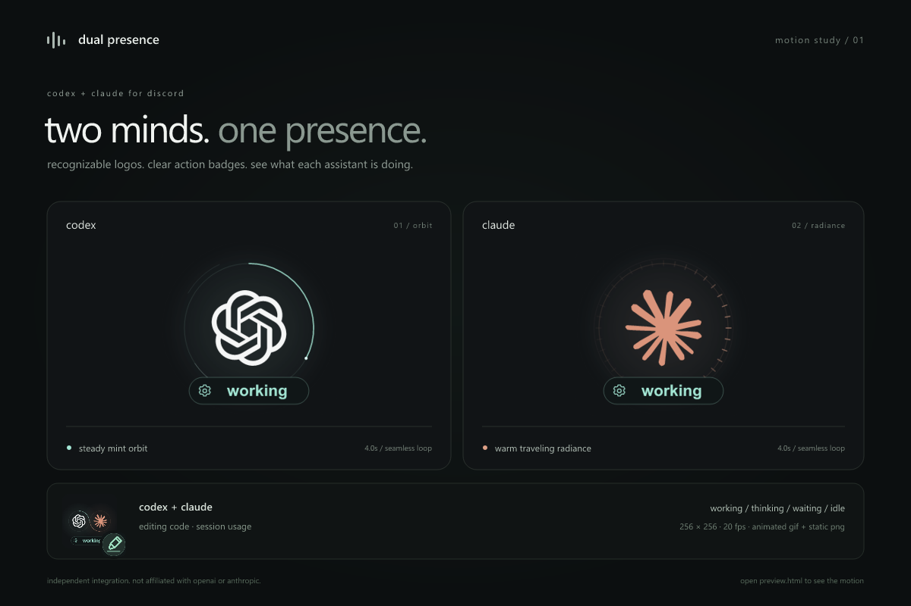
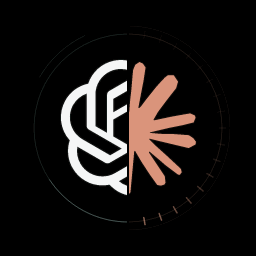

# codex + claude for discord

both assistants, one discord presence. local activity and token usage with distinct, smooth logo animations.



fork of [telljoe/claude-discord-rpc-dist](https://github.com/telljoe/claude-discord-rpc-dist). the original license is preserved. this fork does not update itself from the original repository.

## run

requires node.js 20+ and the discord desktop app. node.js 22.15+ is recommended to include compressed codex history. no npm install, api key, or bot token is needed to run.

```powershell
git clone https://github.com/sagecsharp/codex-claude-discord-rpc.git
cd codex-claude-discord-rpc
node rpc.js
```

the default configuration retains the upstream public discord application id and uses this fork's hosted animations. `name` is set to `codex + claude`; the exact display still depends on your discord client. to use your own discord application or change preferences, run `node scripts/setup.js`.

to install in your user account and start at login:

```powershell
powershell -ExecutionPolicy Bypass -File .\install.ps1
```

the installer copies this local checkout to `%LOCALAPPDATA%\CodexClaudeRPC`. it preserves your config on upgrades. `-NoAutostart` skips the login shortcut; `-NoStart` skips starting it. the original clawd install is separate: stop it before running both with the same discord application id.

## what it shows

- plain-language actions such as `codex: running tests` and `claude: editing files`.
- the saved conversation title beside each active assistant's action.
- both token totals on the same card when both have recent sessions.
- when idle: both logos, all-time locally recorded tokens for each assistant, and their estimated api costs.
- a white chatgpt knot with a mint orbit; a coral claude sun with a warm pulse.
- when both are active, one split logo: chatgpt on the left, claude on the right, with each half showing its own activity.
- four animations for each provider, four paired-logo animations, and nine split-state combinations. each is a seamless four-second, 20 fps loop.
- distinct action badges for editing, reading, searching, testing, terminal commands, browsing, reviewing, thinking, waiting, finished, idle, and other work.
- an elapsed timer and an optional project folder name.

when both assistants are active, every display mode uses a split image with half of each logo. each side animates independently for working, thinking, or waiting. the split stays in place while the small action badge can alternate between assistants. once both are idle, the paired full logos and lifetime totals return.



`auto` follows the active provider when only one is active. the small badge shows the current action: a pencil for edits, a magnifier for searches, a checklist for tests, and a pause icon when waiting for you. `combined` also keeps both logos visible when one recent session is idle. `rotate` gives recent idle providers a turn as the main logo. text keeps both providers' actions and usage visible in every mode. the discord member list uses the action line too.

action text comes from a fixed vocabulary. raw commands, prompts, and tool inputs never appear on discord. fast tool results keep their action visible for up to eight seconds to avoid flicker. a finished action stays visible for `doneSeconds` (20 seconds by default), then the all-time idle card appears.

there is no text baked into the images. the artwork contains only logos, motion, and action pictograms on pure black; labels stay in discord's normal text fields. glow is confined to the logos, with crisp unlit action icons and orbit lines.

open [the interactive animation preview](assets/preview.html) from your local checkout to compare states and pause motion. github displays the html source; download or clone first.

## settings

optional `config.json` overrides [config.example.json](config.example.json). it is ignored by git. for example:

```json
{
  "displayMode": "combined",
  "privacy": "minimal",
  "showTokens": true,
  "showWhenIdle": true,
  "showConversationTitle": true,
  "images": { "animated": true }
}
```

- `privacy`: `minimal` shows provider, state, model, and optional usage. `project` also shows the current folder's name. prompt text, commands, file contents, and full paths are never published. `hideProjects` accepts folder globs such as `client-*`.
- `providers`: set `codex` or `claude` to false to hide that provider.
- `showTokens`: false hides usage and cost. `showWhenIdle`: true (default) shows the all-time idle card; false clears the presence when nothing is active.
- `showConversationTitle`: true in the bundled configuration shows saved conversation titles in discord's text fields. set false to hide them. titles are shortened to fit both assistants when active together; logo hover allows more title text within discord's text limit. missing titles leave the usual action labels visible. titles are read from codex's session index and claude's explicit session/title metadata, never guessed from prompt text.
- `images.baseUrl`: public https directory containing the bundled gifs. `images.animated: false` selects png stills. for developer portal uploads, use the png files, name keys like `codex_working`, and set `images.portal: true`.
- `codexRoot`: custom sessions directory (default `$CODEX_HOME/sessions` or `~/.codex/sessions`). `claudeRoot`: custom claude home (default `$CLAUDE_CONFIG_DIR` or `~/.claude`).
- `codexHistoryRoot`: custom codex home containing `sessions` and `archived_sessions`. defaults to `$CODEX_HOME`, `~/.codex`, or the parent of a custom `codexRoot`.

discord supports animated images through public external urls. uploaded portal assets are static. see [discord's rich presence documentation](https://docs.discord.com/developers/discord-social-sdk/development-guides/setting-rich-presence#uploading-assets).

## usage and activity limits

while active, usage is the sum of recent local session counters, including cached input. `usage pending` means a log has no counter yet; `≥` marks incomplete counters. inherited history in active forked sessions can overlap.

when idle, a separate history index shows all-time locally recorded tokens and estimated api cost for each assistant. it scans codex sessions and archives (including `.jsonl.zst` on node 22.15+), plus claude project and subagent transcripts. stable request/message ids and cumulative-event fingerprints remove copied and repeated usage. incomplete or inferred records remain estimates, not an account-wide billing ledger. deleted history that was never indexed, cloud-only usage, and browser chats cannot be recovered.

the first scan runs in a background worker. later scans run every minute, reusing unchanged files. the local `cache/lifetime-v1.json` stores usage counters and hashed file identifiers, never prompts or transcript text. previously indexed counters remain available when logs are archived or removed. stop the app and delete this cache to rebuild only from currently available files.

costs use published api input, output, and cache rates for the recorded model, with current standard pricing where tier/context metadata is missing. these are hypothetical api costs, not subscription spending or a bill. unknown models and unknown cache-write lifetimes remain `unpriced`; a dollar amount followed by `+ unpriced` is only the priced subtotal. `≥` marks incomplete token coverage. no paid api calls or credentials are used to calculate these estimates. see [pricing sources and assumptions](PRICING.md); `node rpc.js --stats` shows local totals, per-model costs, and coverage.

codex activity is inferred from local rollout events. claude uses local session metadata and transcripts, with a process-liveness check when a pid is available. compressed/archived codex logs contribute to lifetime usage but do not count as live activity. local formats can change between app versions.

silent sessions become idle after `staleMs` (two minutes by default), including long-running tasks with no log events. sessions leave the card after `idleRetentionMs` (ten minutes). bounded reads keep large histories responsive. these limits are configurable.

## preview, test, stop

```powershell
node rpc.js --status --json
node rpc.js --idle --status
node rpc.js --stats
node rpc.js --demo --status
node --test
node rpc.js --stop
```

`--status` never connects to discord. add `--idle` to inspect the idle card without waiting for sessions to finish. `--demo` uses synthetic activity and usage; combine `--demo --idle --status` for a sample lifetime card. `--once` publishes one snapshot, waits for discord to acknowledge it, then clears and exits. `--log` writes a rotating local log.

to remove login startup, run the installed `install-autostart.ps1 -Remove`. stop the daemon before deleting its install folder. this does not remove the original clawd installation.

## developing the animations

runtime has no external dependencies. only regenerating assets requires development packages:

```powershell
npm ci
npm run assets
```

source vectors and their attribution are in [assets/credits.txt](assets/credits.txt). the logos identify the products; this project is not affiliated with openai or anthropic. see [license](LICENSE) and [notice](NOTICE).


this shit is all vibe coded lmfao
