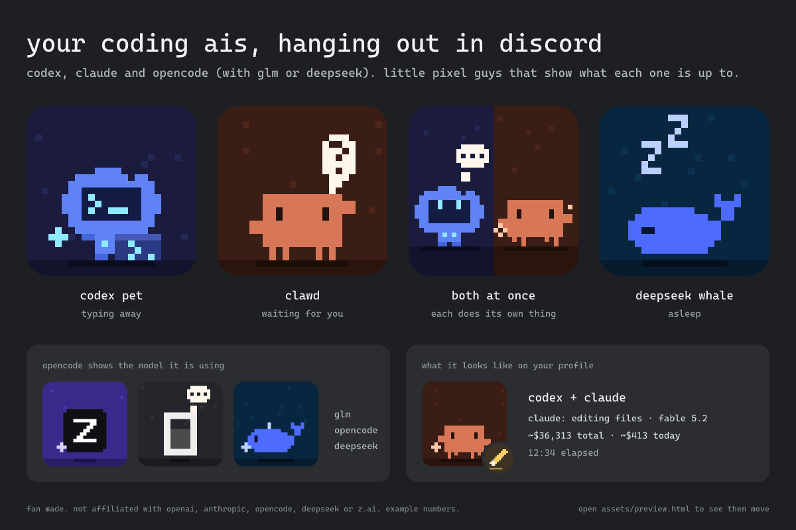

# codex + claude + opencode for discord

three coding assistants, one discord presence. pixel mascots that show what each one is doing, plus token usage where it is available.



fork of [telljoe/claude-discord-rpc-dist](https://github.com/telljoe/claude-discord-rpc-dist). the original license is preserved. this fork does not update itself from the original repository.

## run

requires node.js 20+ and the discord desktop app. node.js 22.15+ is recommended to include compressed codex history. no npm install, api key, or bot token is needed to run.

```powershell
git clone https://github.com/sagecsharp/codex-claude-discord-rpc.git
cd codex-claude-discord-rpc
node rpc.js
```

the default configuration retains the upstream public discord application id and uses this fork's hosted pixel art. the discord application name stays `codex + claude`; the card content covers all three assistants. to use your own discord application or change preferences, run `node scripts/setup.js`.

to install in your user account and start at login:

```powershell
powershell -ExecutionPolicy Bypass -File .\install.ps1
```

the installer copies this local checkout to `%LOCALAPPDATA%\CodexClaudeRPC`. it preserves your config on upgrades. `-NoAutostart` skips the login shortcut; `-NoStart` skips starting it. the original clawd install is separate: stop it before running both with the same discord application id.

## what it shows

- plain-language actions such as `codex: running tests`, `claude: editing files`, and `opencode: searching code`.
- the saved conversation title beside each active codex or claude action. opencode titles are not read.
- the estimated api cost of the pinned providers (claude by default) as an all-time total and today, with recent token counts beside it when codex or claude have sessions. opencode shows its model instead of a pending token number.
- when idle: the codex pet and clawd asleep, all-time locally recorded tokens for each, and their estimated api costs for all-time and today, pinned providers first.
- pixel art mascots instead of logos where the ai has one: clawd for claude, the codex app's pet for codex, and a little whale for deepseek. opencode and glm have no mascot, so their own blocky marks hop around instead.
- each one acts out its state: sparkles while working, a thought bubble while thinking, a `?` bubble when it is waiting for you, and asleep with floating z's when idle.
- opencode shows which model it is using by putting the glm mark or the deepseek whale on the large card. other opencode models fall back to the opencode mark.
- when codex and claude are the two active assistants they share the picture: the codex pet on the left, clawd on the right, each acting out its own state.
- while opencode is active it keeps the large card, so the glm mark or deepseek whale stays visible even when codex or claude are also active. the other actions stay in the text and hover.
- four animations each for codex, claude, plain opencode, glm, and deepseek, four of codex and claude together, and nine mixed-state combinations. each is a short loop of 16 frames at a chunky 8 fps.
- distinct pixel badges for editing, reading, searching, testing, terminal commands, browsing, reviewing, thinking, waiting, finished, idle, and other work.
- an elapsed timer and an optional project folder name.

when codex and claude are the two active assistants, every display mode uses the shared picture with both mascots side by side. each side animates independently for working, thinking, or waiting. it stays in place while the small action badge can alternate between assistants. once nothing is active, both fall asleep and the lifetime totals return.


   

`auto` follows the active provider when only one is active. the small badge shows the current action: a pencil for edits, a magnifier for searches, a bubbling flask for tests, and an hourglass when waiting for you. `combined` also keeps both mascots visible when one recent session is idle. `rotate` gives recent idle providers a turn as the main picture. opencode overrides the rotation while it is active so its model art stays on screen. text keeps every active provider's action and usage visible in every mode. the discord member list uses the action line too.

action text comes from a fixed vocabulary. raw commands, prompts, and tool inputs never appear on discord. fast tool results keep their action visible for up to eight seconds to avoid flicker. a finished action stays visible for `doneSeconds` (20 seconds by default), then the all-time idle card appears.

there is no text baked into the images. the artwork is hard-edged pixel art on a colored tile per assistant; labels stay in discord's normal text fields.

open [the interactive animation preview](assets/preview.html) from your local checkout to try every state and action and pause the motion. github displays the html source; download or clone first.

## settings

optional `config.json` overrides [config.example.json](config.example.json). it is ignored by git. for example:

```json
{
  "displayMode": "combined",
  "privacy": "minimal",
  "showTokens": true,
  "showWhenIdle": true,
  "showConversationTitle": true,
  "images": { "animated": true }
}
```

- `privacy`: `minimal` shows provider, state, model, and optional usage. `project` also shows the current folder's name. prompt text, commands, file contents, and full paths are never published. `hideProjects` accepts folder globs such as `client-*`.
- `providers`: set `codex`, `claude`, or `opencode` to false to hide that provider. opencode shows the glm mark or the deepseek whale while that model is active; other models use the plain opencode mark.
- `alwaysShowCost`: providers (`codex` and/or `claude`, default `["claude"]`) whose estimated cost stays on the card even when another provider is the one working. a codex or claude session on the card also shows its own cost once the history index is ready. opencode has no cost. `[]` shows cost only for the codex and claude sessions on the card.
- `showTokens`: false hides usage and the cost line. `showWhenIdle`: true (default) shows the all-time idle card; false clears the presence when nothing is active.
- `showConversationTitle`: true in the bundled configuration shows saved conversation titles in discord's text fields. set false to hide them. titles are shortened to fit the active assistants; hovering the picture allows more title text within discord's text limit. missing titles leave the usual action labels visible. titles are read from codex's session index and claude's explicit session/title metadata, never guessed from prompt text, and opencode titles are not read.
- `images.baseUrl`: public https directory containing the bundled gifs. `images.animated: false` selects png stills. for developer portal uploads, use the png files and name keys like `codex_working`, `claude_working`, `deepseek_working`, `glm_working`, and `opencode_working`, then set `images.portal: true`.
- `codexRoot`: custom sessions directory (default `$CODEX_HOME/sessions` or `~/.codex/sessions`). `claudeRoot`: custom claude home (default `$CLAUDE_CONFIG_DIR` or `~/.claude`). `opencodeRoot`: custom opencode data directory (default `$OPENCODE_DATA_DIR`, `$XDG_DATA_HOME/opencode`, or `~/.local/share/opencode`).
- `codexHistoryRoot`: custom codex home containing `sessions` and `archived_sessions`. defaults to `$CODEX_HOME`, `~/.codex`, or the parent of a custom `codexRoot`.

discord supports animated images through public external urls. uploaded portal assets are static. see [discord's rich presence documentation](https://docs.discord.com/developers/discord-social-sdk/development-guides/setting-rich-presence#uploading-assets).

## usage and activity limits

while active, usage is the sum of recent local session counters for codex and claude, including cached input. opencode contributes live activity and model information only; its token history stays in opencode's own database and is not scanned for the lifetime card. `usage pending` means a log has no counter yet; `≥` marks incomplete counters. inherited history in active forked sessions can overlap.

when idle, a separate history index shows all-time locally recorded tokens and estimated api cost for codex and claude. it scans codex sessions and archives (including `.jsonl.zst` on node 22.15+), plus claude project and subagent transcripts. stable request/message ids and cumulative-event fingerprints remove copied and repeated usage. incomplete or inferred records remain estimates, not an account-wide billing ledger. deleted history that was never indexed, cloud-only usage, and browser chats cannot be recovered.

the first scan runs in a background worker. later scans run every minute, reusing unchanged files. the local `cache/lifetime-v2` folder stores usage counters and hashed file identifiers, never prompts or transcript text. it is split into small files, so a scan only rewrites the ones whose logs changed and writes nothing when nothing changed. previously indexed counters remain available when logs are archived or removed. a `cache/lifetime-v1.json` left by an older version is imported once and can be deleted after that. stop the app and delete the folder (and the old file, if it is still there) to rebuild only from currently available files.

once the history index is ready, the active card shows the estimated api cost for the pinned providers as an all-time total and today, for example `~$36,313 total · ~$413 today`. today runs from local midnight to now, by each request's own timestamp, and refreshes with the once-a-minute history scan. `~` marks an estimate and a `+` after an amount means more than 0.1% of those tokens could not be priced. a provider with no priced usage shows no cost on the active card, and a pinned provider with no history at all stays off it. usage replayed into a forked or subagent log counts on the day it was first spent. it is still a hypothetical api cost, not a bill. `showTokens: false` hides it.

costs use published api input, output, and cache rates for the recorded model, with current standard pricing where tier/context metadata is missing. these are hypothetical api costs, not subscription spending or a bill. unknown models and unknown cache-write lifetimes remain `unpriced`; an amount followed by `+` is only the priced subtotal (shown once more than 0.1% of the tokens are unpriced). `≥` marks incomplete token coverage. no paid api calls or credentials are used to calculate these estimates. see [pricing sources and assumptions](PRICING.md); `node rpc.js --stats` shows local totals, per-model costs, and coverage.

codex activity is inferred from local rollout events. claude uses local session metadata and transcripts, with a process-liveness check when a pid is available. opencode is read from its local append-only log at `log/opencode.log`: only key/value metadata such as session id, provider, model, and permission action is used, never prompts, file contents, or command output. the reader tails new lines and starts from the last 512 kb on launch. compressed/archived codex logs contribute to lifetime usage but do not count as live activity. local formats can change between app versions.

silent sessions become idle after `staleMs` (two minutes by default), including long-running tasks with no log events. sessions leave the card after `idleRetentionMs` (ten minutes). bounded reads keep large histories responsive. these limits are configurable.

## preview, test, stop

```powershell
node rpc.js --status --json
node rpc.js --idle --status
node rpc.js --stats
node rpc.js --demo --status
node --test
node rpc.js --stop
```

`--status` never connects to discord. add `--idle` to inspect the idle card without waiting for sessions to finish. `--demo` uses synthetic activity and usage; combine `--demo --idle --status` for a sample lifetime card. `--once` publishes one snapshot, waits for discord to acknowledge it, then clears and exits. `--log` writes a rotating local log.

to remove login startup, run the installed `install-autostart.ps1 -Remove`. stop the daemon before deleting its install folder. this does not remove the original clawd installation.

## developing the animations

runtime has no external dependencies. only regenerating assets requires development packages:

```powershell
npm ci
npm run assets
```

all of the art is drawn in code (`scripts/pixel-art.cjs`, `scripts/action-art.cjs`); nothing is copied from official image files. the characters are fan redraws that identify the products, and what each one is based on is listed in [assets/credits.txt](assets/credits.txt). this project is not affiliated with openai, anthropic, opencode, deepseek, or zhipu ai. see [license](LICENSE) and [notice](NOTICE).


this shit is all vibe coded lmfao
